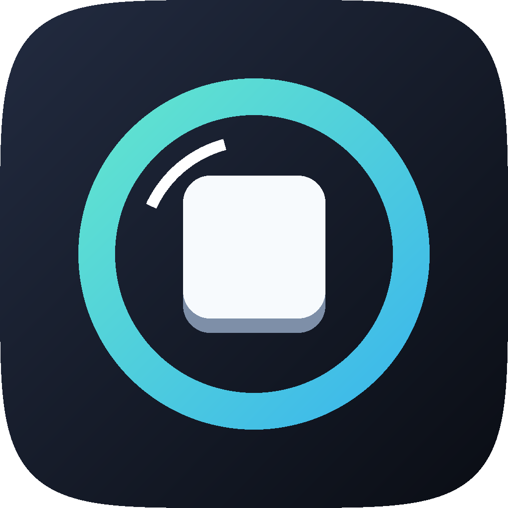

<p align="center"></p>

<h1 align="center">Chojema InputLens</h1>

<p align="center">누른 키와 마우스 입력을 화면에 잠깐 보여 주는 가벼운 상주 앱<br>A lightweight tray app that briefly shows your key and mouse input on screen</p>

> 개발 초기 단계이며 아직 공개 릴리스가 없습니다. 현재 Windows 버전만 있습니다.
> Early development. No public release yet. Only the Windows version exists for now.

## 표시되는 입력 (What it shows)

| 입력 (Input) | 표시 (Display) |
|---|---|
| 조합 키 (Key combinations) | `Ctrl + C`, `Alt + Tab` |
| 기능·이동·IME 키 (Function, navigation, IME keys) | `F5`, `Esc`, `←`, `한/영` |
| 마우스 (Mouse) | 누른 버튼이나 휠 방향을 강조한 마우스 그림 (A mouse image highlighting the button or wheel direction) |

수정키 없이 입력하는 글자, 숫자, 기호, 공백은 표시하지 않습니다.
Letters, digits, symbols and spaces typed without a modifier are not shown.

## 개인정보 (Privacy)

입력 내용을 파일에 저장하거나 네트워크로 전송하지 않습니다. 트레이 메뉴의 **일시정지**를 켜면 입력 수신 자체를 중단합니다.
Input is never written to a file or sent over the network. **Pause** in the tray menu stops input reception entirely.

## 사용법 (Usage)

`ChojemaInputLens.exe`를 실행하면 알림 영역에 아이콘이 나타납니다. 아이콘을 클릭하면 일시정지, 마우스 표시, 정보, 종료 메뉴가 열립니다.
Run `ChojemaInputLens.exe` and an icon appears in the notification area. Click it for Pause, Show mouse, About and Exit.

## 제한 사항 (Limitations)

- 관리자 권한으로 실행한 창에 포커스가 있으면 입력이 표시되지 않을 수 있습니다.
  Input may not appear while a window running as administrator has focus.
- 독점 전체 화면 앱 위에는 표시되지 않을 수 있습니다.
  The overlay may not appear over exclusive full-screen apps.
- `Ctrl + Alt + Del`은 표시되지 않습니다.
  `Ctrl + Alt + Del` is not shown.

## 빌드 (Build)

Windows 10 이상, Visual Studio C++ 도구, CMake, Ninja가 필요합니다. 개발자 명령 프롬프트에서 실행합니다.
Requires Windows 10 or later, Visual Studio C++ tools, CMake and Ninja. Run from a Developer Command Prompt.

```
cmake --preset release
cmake --build --preset release
```

## 변경 내역 (Changelog)

[CHANGELOG.md](CHANGELOG.md)

## 라이선스 (License)

[MIT](LICENSE) © 2026 Chulwoo Park
